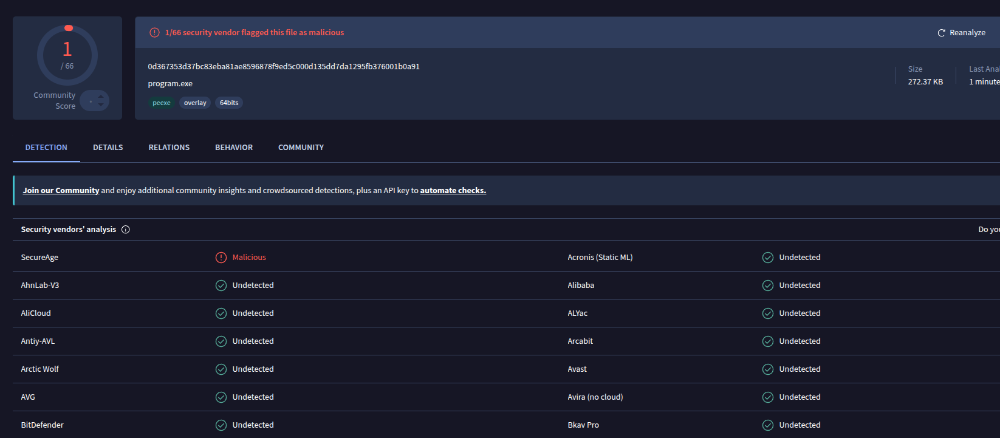

# Ransomware (Educational Project)

> DISCLAIMER: This project is for educational and research purposes only.
> The author is not responsible for any misuse. Do not use this code for illegal activities.
> All techniques demonstrated here are intended to help security professionals understand
> how ransomware works in order to better defend against it.

---

## Overview

This is an educational implementation of a ransomware sample written in C. The goal of this
project is to demonstrate, in a controlled and documented way, the techniques commonly used by
real-world ransomware families:

- File encryption / decryption (AES + RSA hybrid scheme)
- File system traversal (recursive directory walking)
- API interaction (Windows API wrappers)
- Code obfuscation (string obfuscation, control-flow flattening, junk code)
- Anti-analysis techniques (delays, API hashing, indirect syscalls)

The project is not intended to be used in the wild. It does not include propagation,
C2 infrastructure, or any real-world weaponization.

---

## VirusTotal Detection

One of the main goals of this project was to study how obfuscation affects AV detection
rates. The compiled sample was uploaded to VirusTotal for analysis.

Result at the time of testing:

- Detections: 1 / 66 engines
- Windows Defender: not detected
- Kaspersky: not detected
- BitDefender: not detected
- CrowdStrike: not detected

Note: Detection rates change over time as AV vendors update their signatures. The result
above reflects the state at the time of publication only. No guarantee is made about
future detection rates.

Key techniques that helped reduce detection:

| Technique | Purpose |
|-----------|---------|
| String obfuscation (XOR + runtime decode) | Hides suspicious strings from static analysis |
| API hashing | Avoids importing suspicious functions by name |
| Indirect syscalls | Bypasses userland hooks |
| Junk code insertion | Confuses signature-based detection |
| Delayed execution | Evades sandbox timeouts |
| Control-flow flattening | Makes reverse engineering harder |

---

## Project Structure

`
```text
Ransom/
└── src/
    ├── api.c / api.h - Windows API wrappers (dynamic loading, hashing)
    ├── arrays.c - Array utilities (byte manipulation, encoding)
    ├── crypto.c / crypto.h - Cryptographic operations (AES-256 + RSA-2048)
    ├── files.c / files.h - File system traversal and manipulation
    ├── main.c - Entry point
    └── obfuscate.c / obfuscate.h - String obfuscation and anti-analysis
```
`

### Module breakdown

| File | Description |
|------|-------------|
| api.c | Dynamically resolves Windows API functions via GetProcAddress and API hashing |
| arrays.c | Helper functions for byte-array manipulation, XOR, and Base64 |
| crypto.c | AES-256-CBC encryption + RSA-2048 key wrapping |
| files.c | Recursive directory traversal, file extension filtering, file I/O |
| main.c | Orchestrates the encryption flow |
| obfuscate.c | Compile-time and runtime string obfuscation, junk code generation |

## Build

### Requirements

- Windows (tested on Windows 11)
- MinGW-w64 or MSVC 2019+
- OpenSSL (for cryptographic primitives)

### 1. Generate RSA keys

Before compiling, you need to generate the RSA key pair used by the ransomware.
The public key is embedded in the binary; the private key must be kept separately.

```bash
# Generate private key (2048-bit)
openssl genrsa -out private.pem 2048

# Extract public key from private key
openssl rsa -in private.pem -pubout -out public.pem
```

### 2.1 Compile with MinGW-w64 (Linux)

Requires mingw-w64 installed:

```bash
x86_64-w64-mingw32-gcc -O2 -s -o ransom.exe src/*.c -lcrypto -lws2_32 -mwindows -DQUIET
```

### 2.2 Compile on Windows (Native)

```cmd
cl /O2 /Fe:ransom.exe src\*.c /link libcrypto.lib ws2_32.lib
```
Make sure OpenSSL is installed. 


## Cryptographic Scheme
The ransomware uses a hybrid encryption scheme, which is the standard approach used by real‑world families:

- A random AES‑256 key is generated for each file.
- The file is encrypted with AES‑256‑CBC.
- The AES key is encrypted with an RSA‑2048 public key embedded in the binary.
- The encrypted AES key is appended to the file.
- The original file is deleted (or overwritten).

Without the RSA private key (which is not in the binary), decryption is infeasible.

For safety, the private key in this educational version is hard‑coded and documented in the source. In a real ransomware, it would be held by the attacker.

## Testing
The project was tested in an isolated Windows VM with:

- Windows Defender enabled and up to date
- No network access (to prevent accidental C2 traffic)
- A snapshot taken before execution for easy rollback

### Test results

- **Windows Defender**: did not detect the sample on execution
- **VirusTotal**: 1 detections at the time of testing




- Files encrypted successfully with no crashes


## References
- MITRE ATT&CK – Data Encrypted for Impact (T1486)
- MITRE ATT&CK – Obfuscated Files or Information (T1027)
- The Art of Mac Malware – Obfuscation
- Practical Malware Analysis (book)

## Legal
This code is provided "as is" for educational purposes only.

- Do not use it against systems you do not own.
- Do not distribute it as a weapon.
- Do not upload it to public repositories without a clear disclaimer.

Using ransomware against systems you do not own is illegal in most jurisdictions and can result in severe criminal penalties.

The author assumes no liability for any misuse of this code.
